<div align="center">

<!-- Hero Animated Quantum SVG Banner -->
<a href="https://github.com/Weirdgamer20">
  
</a>

<br/>

<!-- Dynamic High-Tech Typewriter Banner -->
<a href="https://github.com/Weirdgamer20">
  
</a>

<br/>

<!-- Holographic Status Badges -->
<p align="center">
  <a href="https://github.com/Weirdgamer20">
    
  </a>
  <a href="https://github.com/Weirdgamer20">
    
  </a>
  <a href="https://github.com/Weirdgamer20/SIH2026-Quantum-VRP">
    
  </a>
  <a href="https://www.linkedin.com/in/ashishlal20">
    
  </a>
</p>

<p align="center">
  <i>Building intelligent systems at the boundary of <b>machine learning</b>, <b>software architecture</b>, and <b>autonomous decision-making</b>.</i>
</p>

</div>

---

### ⚡ System Telemetry Quick HUD

```yaml
Operator       : Ashish Lal (@Weirdgamer20)
Specialization : AI Systems · Deep Reinforcement Learning · Deterministic Backend
Core Directive : "Build systems, not demos."
Boundary Logic : Strict separation between learned heuristic policies and deterministic execution invariants
Active Quorum  : 6 Repositories Indexed · 1 Quantum Research Frontier
System Health  : [||||||||||||||||||||||||||||||||||||||||] 100% Deterministic Safety
```

---

## 🏛️ Core Engineering Creed

> ### **"Build systems, not demos."**
> 
> *I value explicit interfaces, deterministic boundaries around learned components, reproducibility, measurable behavior, and failure-aware design.*

<details>
<summary><b>🔍 Expand Systems Philosophy & Boundary Contracts</b></summary>

<br/>

1. **Deterministic Boundaries around Stochastic Models:**  
   Learned models (RL policies, LLMs, neural networks) are probabilistic generators. They must **never** hold direct custody of capital, destructive execution, or unvalidated state transitions. Every output passes through deterministic invariant check gates (written in Rust or type-safe strict cores).
2. **Failure-First Architecture:**  
   Systems are evaluated not on ideal-condition benchmarks, but on failure state recovery, out-of-distribution graceful degradation, and auditability.
3. **Measurable Telemetry Over Intuition:**  
   Zero gut-feel optimizations. Every decision must be measurable via vector rollouts, entropy convergence, and latency telemetry.

</details>

---

## 🔬 Active Research Spotlight

### ⚛️ [SIH2026 Quantum VRP / AQTRO](https://github.com/Weirdgamer20/SIH2026-Quantum-VRP)
> **Combinatorial Quantum Annealing & Meta-Learned Heuristics for Vehicle Routing**

<p align="center">
  
  
  
  
</p>

Vehicle Routing Problems (VRP) exhibit factorial combinatorial explosion $\mathcal{O}(n!)$. This research investigates translating hard routing constraints into **Quadratic Unconstrained Binary Optimization (QUBO)** matrices, benchmarked on simulated quantum annealing and QAOA circuits:

```
Hamiltonian Formulation:
H = ∑ C_ij · x_ij  +  λ₁ ∑ (1 - ∑ x_ij)²  +  λ₂ ∑ SubtourPenalty(k)
    └─ Cost Matrix ─┘  └── Degree Boundary ──┘  └── Topological Invariant ──┘
```

- **Key Finding:** Meta-learning warm-start policy reduces quantum circuit depth by **~42%** on clustered distribution topologies.
- **Repository:** [SIH2026-Quantum-VRP →](https://github.com/Weirdgamer20/SIH2026-Quantum-VRP)

---

## 🚀 Selected Production & Research Systems

<table>
<tr>
<td width="50%" valign="top">

### 🛡️ [TradeHive](https://github.com/Weirdgamer20/tradehive)
**Reinforcement-learning trading infrastructure**

A systems-oriented trading platform separating learned strategy from deterministic risk, execution, and reconciliation.

`Rust` `Deep RL` `Risk Systems` `Async Tokio`

```
[Deep RL Strategy] ──(Signals)──> [Deterministic Risk Gate]
                                          │
                               (Passed Invariants)
                                          ▼
                               [Microsecond Order Core]
```

<details>
<summary><b>Inspect Architectural Contracts</b></summary>

- **RL Strategy:** Decoupled continuous action space generation (PPO / DQN).
- **Risk Gate:** Rust zero-cost safety checks enforcing drawdown limits, max position exposure, and volatility haircuts prior to exchange routing.
- **Ledger:** Atomic reconciliation with sub-millisecond execution telemetry.

</details>

[**Explore Repository →**](https://github.com/Weirdgamer20/tradehive)

</td>
<td width="50%" valign="top">

### 🌐 [EcoConnect](https://github.com/Weirdgamer20/Eco-connect)
**AI civic issue intelligence platform**

A full-stack platform for collecting civic reports, applying AI triage, clustering related issues, and routing them toward accountable resolution.

`Next.js` `TypeScript` `PostgreSQL` `Redis` `Vector AI`

```
[Multi-Modal Intake] ──> [Semantic Vector Clustering]
                                     │
                             (Deduplicated Queue)
                                     ▼
                          [Civic Routing Engine]
```

<details>
<summary><b>Inspect Architectural Contracts</b></summary>

- **Multi-Modal Intake:** Geospatial coordinate hashing and image parsing.
- **AI Triage:** Cosine similarity vector clustering eliminating duplicate citizen reports across municipal sectors.
- **Workers:** Distributed Redis event stream processing with PostgreSQL persistence.

</details>

[**Explore Repository →**](https://github.com/Weirdgamer20/Eco-connect)

</td>
</tr>
<tr>
<td width="50%" valign="top">

### 🕹️ [RLLS16](https://github.com/Weirdgamer20/RLLS16)
**Reinforcement-learning simulation environment**

An experimental environment for studying autonomous agents, world dynamics, spatial behavior, and measurable simulation outcomes.

`Python` `PyTorch` `RL` `Simulation` `Gymnasium`

<details>
<summary><b>Inspect Architectural Contracts</b></summary>

- **Vectorized Rollouts:** Matrix-accelerated step transitions running at 10k+ steps/second.
- **Policy Telemetry:** Real-time logging of policy divergence, entropy decay, and state exploration coverage.

</details>

[**Explore Repository →**](https://github.com/Weirdgamer20/RLLS16)

</td>
<td width="50%" valign="top">

### 🤖 [Mine-Bot](https://github.com/Weirdgamer20/Mine-Bot)
**Autonomous learning agent for complex environments**

Moving beyond brittle scripted heuristics toward perception, spatial memory, latent world models, and continuous environmental feedback.

`Python` `RL` `World Models` `Hierarchical Planning`

<details>
<summary><b>Inspect Architectural Contracts</b></summary>

- **Perception Encoder:** Voxel state representation with spatial-temporal embeddings.
- **World Model:** Latent dynamics predicting environmental rollouts for multi-step trajectory planning.

</details>

[**Explore Repository →**](https://github.com/Weirdgamer20/Mine-Bot)

</td>
</tr>
<tr>
<td width="50%" valign="top" colspan="2">

### 🌾 [Farm Advisor](https://github.com/Weirdgamer20/farm-advisor-1)
**Applied machine learning for agricultural intelligence & computer vision**

Crop recommendation, soil intelligence, weather context, and disease-oriented computer vision in one applied ML system.

`FastAPI` `React` `Scikit-learn` `TensorFlow` `Computer Vision`

<details>
<summary><b>Inspect Architectural Contracts</b></summary>

- **Vision Diagnostics:** Deep transfer learning CNN classifying leaf pathology with calibrated uncertainty scoring.
- **Tabular Regressor:** Gradient-boosted multi-factor ensemble analyzing NPK ratios, rainfall metrics, and pH profiles.
- **Serving:** Low-latency asynchronous FastAPI microservice with responsive web telemetry UI.

</details>

[**Explore Repository →**](https://github.com/Weirdgamer20/farm-advisor-1)

</td>
</tr>
</table>

---

## 🛠️ Engineering Stack & Telemetry Matrix

<div align="center">

| Domain | Core Stack & Frameworks | Architectural Role |
| :--- | :--- | :--- |
| **AI / ML & RL** | `PyTorch` · `TensorFlow` · `Scikit-learn` · `Gymnasium` · `NumPy` | Policy optimization, latent dynamics, feature engineering |
| **Systems & Core** | `Rust` · `Python 3.12+` · `Tokio Async` · `Pydantic v2` | Zero-cost abstractions, deterministic risk gates, safety invariants |
| **Backend & APIs** | `FastAPI` · `Node.js` · `Next.js` · `TypeScript` · `REST` | Type-safe RPC contracts, streaming workers, event queues |
| **Persistence** | `PostgreSQL` · `PostGIS` · `Redis` · `Vector DB` | Relational integrity, temporal queries, low-latency caching |
| **Quantum & Opt** | `QUBO` · `QAOA` · `Simulated Annealing` · `SciPy` | Combinatorial optimization, Hamiltonian formulation |
| **Infrastructure** | `Docker` · `GitHub Actions` · `AWS` · `Railway` · `Linux` | Hermetic containers, automated CI/CD verification |

</div>

<br/>

<p align="center">
  <!-- Shields.io Badges Grid -->
  
  
  
  
  
  
  
  
  
</p>

---

## 📊 Live GitHub Telemetry & Activity

<div align="center">

<table border="0">
<tr>
<td width="50%" align="center">
  
</td>
<td width="50%" align="center">
  
</td>
</tr>
<tr>
<td colspan="2" align="center">
  
</td>
</tr>
</table>

</div>

---

<div align="center">

### 📡 Telemetry & Neural Uplink

Let's collaborate on production AI systems, reinforcement learning architectures, or quantum optimization.

<p align="center">
  <a href="https://www.linkedin.com/in/ashishlal20">
    
  </a>
  &nbsp;
  <a href="https://github.com/Weirdgamer20">
    
  </a>
  &nbsp;
  <a href="mailto:ashishlal.dev@gmail.com">
    
  </a>
</p>

```
[SYSTEM TRANSMISSION // END OF TELEMETRY STREAM]
HASH: 0x9F41B // REPRODUCIBLE · DETERMINISTIC · AUDITABLE
```

</div>
